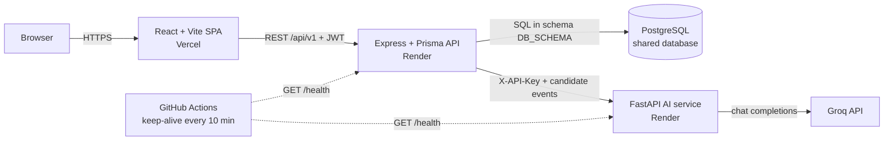

# Quad: College Event Aggregator

**Every campus event, one place.** Students find and book hackathons, fests, talks and match days; organizers publish events; faculty approve them; admins see the whole campus at a glance.

[](https://github.com/HarshBathija-04/College-event/actions/workflows/ci.yml)


| | |
| --- | --- |
| Live demo | `https://<your-app>.vercel.app` _(placeholder)_ |
| API health | `https://quad-api.onrender.com/health` _(placeholder)_ |
| AI service health | `https://quad-ai.onrender.com/health` _(placeholder)_ |

**Demo accounts** (password `Demo@1234`, one-click buttons on the login page): `student@example.edu`, `organizer@example.edu`, `faculty@example.edu`, `admin@example.edu`.

> The API runs on Render's free tier and sleeps when idle. The first request can take 30 to 60 seconds; the app shows a "waking up the server" banner meanwhile.

## Features

- **Discover**: category and format filters plus natural-language search (stemming, synonyms, TF-IDF ranking).
- **Book in one tap**: live seat counts, cancel any time, add to calendar (`.ics`), share.
- **Personalized picks**: a hybrid recommender (interests, popularity, time-to-event) that explains every pick.
- **Ask Quad**: a chat assistant grounded only in real listings, powered by Groq.
- **AI description writer** that turns an organizer's notes into a description, tagline and tags.
- **Approval workflow**: organizer events go to a faculty review queue; reviewers approve or request changes with a note.
- **Role-aware dashboards** for students and organizers, an admin overview and user management.
- **Notifications** for confirmations, approvals and scheduled reminders.
- Light and dark themes, responsive down to 375 px, keyboard and screen-reader friendly.

## Screenshots

| Landing | Discover |
| --- | --- |
|  |  |
| **Event detail** | **Ask Quad assistant** |
|  |  |
| **Student dashboard** | **Create event with the AI writer** |
|  |  |
| **Faculty review queue** | **Admin overview (dark)** |
|  |  |

<p align="center"></p>

## Architecture



## Engineering highlights

- **Schema-per-app database.** Several portfolio apps share one Postgres instance. Every query and migration is scoped to `DB_SCHEMA` (validated against a strict identifier pattern) through `backend/scripts/db.js` and `src/config/env.ts`, so apps never see each other's tables.
- **Double booking is impossible.** A unique `(userId, eventId)` constraint backs registration; cancelling frees the seat (seat counts ignore cancelled rows) and rebooking re-activates the same row with an upsert.
- **AI degrades gracefully.** The backend owns all data and sends only candidate events to a stateless AI service. The client never throws: ranking and search fall back to rule-based results when the service is asleep, and LLM features return clear 429 or 503 messages. Groq is only called server-side.
- **Privacy by default.** Event detail returns only the viewer's own registration, never the attendee list. Unpublished events return 404 to anyone who is not the organizer or a reviewer.
- **Defence in depth.** Helmet, a CORS allow-list, request validation at every route, a 100 kb body limit and three rate limiters (global, auth, AI). Role and account status are re-read from the database on every authenticated request, so a suspension takes effect immediately.
- **Real integration tests.** Supertest runs against a real Postgres in its own `college_event_test` schema, covering auth, the full organizer to faculty to student lifecycle and dashboards. CI runs lint, tests and builds for all three services.
- **Cold-start UX.** A keep-alive workflow pings both services, and the frontend shows a banner when a request is slow because Render is waking up.

## Tech stack

| Layer | Tech |
| --- | --- |
| Frontend | React 19, TypeScript, Vite 7, Tailwind CSS 3, Radix UI, lucide icons, sonner |
| Backend | Node.js 20+, Express 4, Prisma 5 (PostgreSQL), JWT + bcrypt, express-validator, helmet, express-rate-limit, winston, node-cron |
| AI service | Python 3.13, FastAPI, scikit-learn (TF-IDF), NLTK, Groq SDK |
| Infra | Vercel, Render (Blueprint), GitHub Actions (CI + keep-alive) |
| Quality | Vitest, Supertest, pytest, ESLint, Ruff, Prettier |

## Quick start

Prerequisites: Node 20+, Python 3.13 and any Postgres database.

```bash
# 1. Backend API on :5116
cd backend
cp .env.example .env          # set DATABASE_URL (and DB_SCHEMA if you like)
npm install
npm run db:deploy             # creates the schema, runs migrations
npm run db:seed               # idempotent demo data
npm run dev

# 2. AI service on :5117 (optional: the app falls back without it)
cd ai-service
python -m venv .venv && source .venv/bin/activate   # Windows: .venv\Scripts\activate
pip install -r requirements-dev.txt
cp .env.example .env          # same AI_SERVICE_API_KEY as the backend, plus GROQ_API_KEY
uvicorn main:app --app-dir src --port 5117 --reload

# 3. Frontend on :5208
cd app
cp .env.example .env.local    # VITE_API_URL=http://localhost:5116
npm install
npm run dev
```

Checks (the same ones CI runs):

```bash
cd backend    && npm run lint && npm test && npm run build   # tests use schema college_event_test
cd ai-service && ruff check src tests && pytest
cd app        && npm run lint && npm test && npm run build
```

## Environment variables

| Service | Variable | Required | Description |
| --- | --- | --- | --- |
| backend | `DATABASE_URL` | yes | Postgres connection string (the shared database) |
| backend | `DB_SCHEMA` | no | Schema for this app's tables (default `college_event`) |
| backend | `JWT_SECRET` | in production | Signs tokens; the refresh secret is derived unless `JWT_REFRESH_SECRET` is set |
| backend | `JWT_EXPIRES_IN`, `JWT_REFRESH_EXPIRES_IN` | no | Token lifetimes (default `15m`, `7d`) |
| backend | `FRONTEND_URL` | in production | Allowed CORS origins, comma-separated |
| backend | `AI_SERVICE_URL` | no | AI service base URL (default `http://localhost:5117`) |
| backend | `AI_SERVICE_API_KEY` | in production | Shared secret sent to the AI service |
| backend | `ENABLE_CRON` | no | `false` turns off scheduled notification jobs |
| backend | `PORT`, `NODE_ENV`, `LOG_LEVEL` | no | Set by Render |
| ai-service | `GROQ_API_KEY` | for LLM features | Without it the assistant and writer return 503 |
| ai-service | `AI_SERVICE_API_KEY` | in production | Must match the backend |
| ai-service | `GROQ_TEXT_MODEL` | no | Defaults to `openai/gpt-oss-120b` |
| ai-service | `ENVIRONMENT` | no | `production` hides `/docs` and enforces the API key |
| ai-service | `CORS_ORIGINS` | no | Only if a browser should call the service directly |
| app | `VITE_API_URL` | yes | Backend origin, e.g. `https://quad-api.onrender.com` |

## Deploy

1. **Database.** Use the shared Postgres instance and copy its connection string. No per-app database is needed.
2. **Render Blueprint.** In Render choose *New > Blueprint* and pick this repo. `render.yaml` creates `quad-api` and `quad-ai` on the free plan with `/health` checks, sets `DB_SCHEMA=college_event`, and generates `JWT_SECRET` and the shared `AI_SERVICE_API_KEY`. When prompted, set:
   - `quad-api`: `DATABASE_URL` (the shared database), `FRONTEND_URL` (your Vercel URL), `AI_SERVICE_URL` (the `quad-ai` URL).
   - `quad-ai`: `GROQ_API_KEY`.

   Migrations and the idempotent seed run on every boot (`npm run start:prod`).
3. **Vercel.** *Add New > Project*, import the repo, set **Root Directory** to `app` and `VITE_API_URL` to the `quad-api` URL. `app/vercel.json` adds SPA rewrites and security headers. Then put the final Vercel domain in `FRONTEND_URL` on Render.
4. **Keep-alive.** In GitHub *Settings > Secrets and variables > Actions > Variables*, add `BACKEND_URL` (the `quad-api` URL) and optionally `AI_SERVICE_URL`. `.github/workflows/keep-alive.yml` pings `/health` every 10 minutes and skips cleanly when a variable is unset.

## Project structure

```
.
├── app/                     React + Vite frontend (Vercel)
│   └── src/
│       ├── components/app/  EventCard, AssistantWidget, states, brand
│       ├── components/ui/   Radix-based primitives
│       ├── hooks/           auth, theme, async loader
│       ├── layouts/         main and auth shells
│       ├── lib/             API client and formatting helpers (+ tests)
│       └── pages/           route screens
├── backend/                 Express + Prisma API (Render)
│   ├── prisma/              schema and migrations
│   ├── scripts/db.js        schema-scoped Prisma CLI wrapper
│   ├── src/                 routes, controllers, middleware, services, seed
│   └── tests/               Vitest + Supertest
├── ai-service/              FastAPI AI service (Render)
│   ├── src/services/        recommendation, search, categorization, Groq
│   └── tests/
├── docs/                    project report and screenshots
├── render.yaml              Render Blueprint
└── .github/workflows/       CI and keep-alive
```

## Author

Built by [Harsh Bathija](https://github.com/HarshBathija-04). The original MCA project report is in [`docs/`](docs/).
