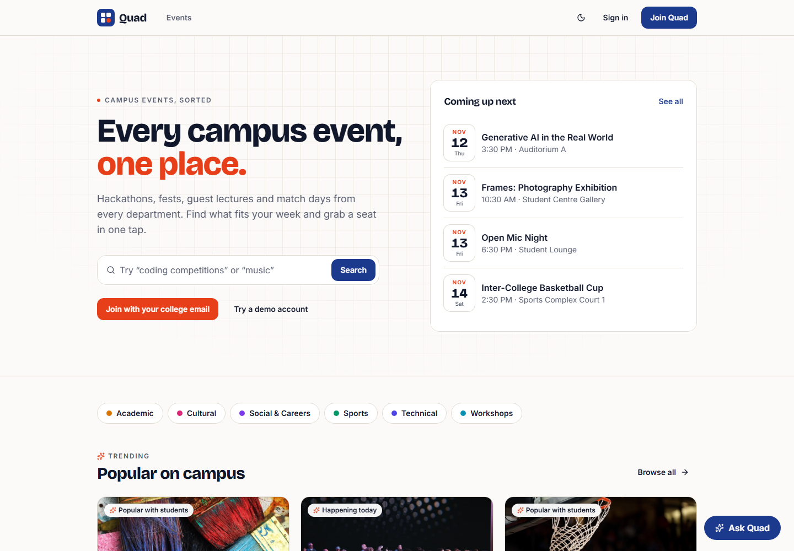
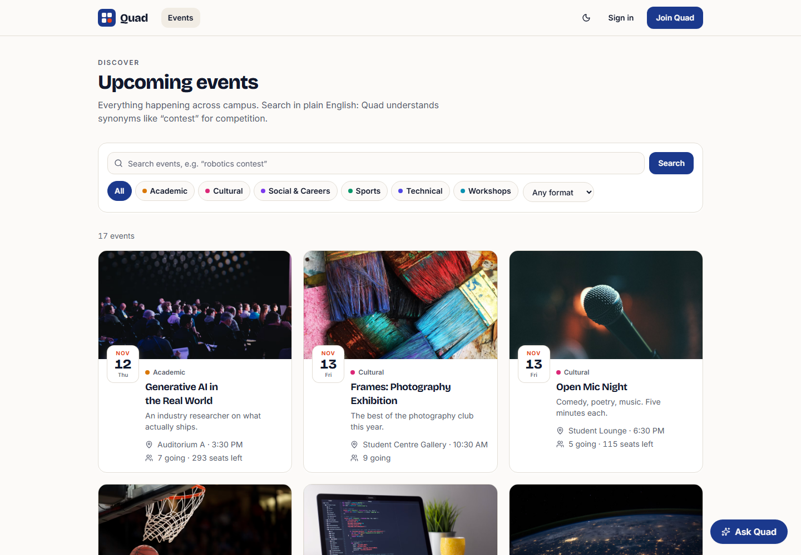
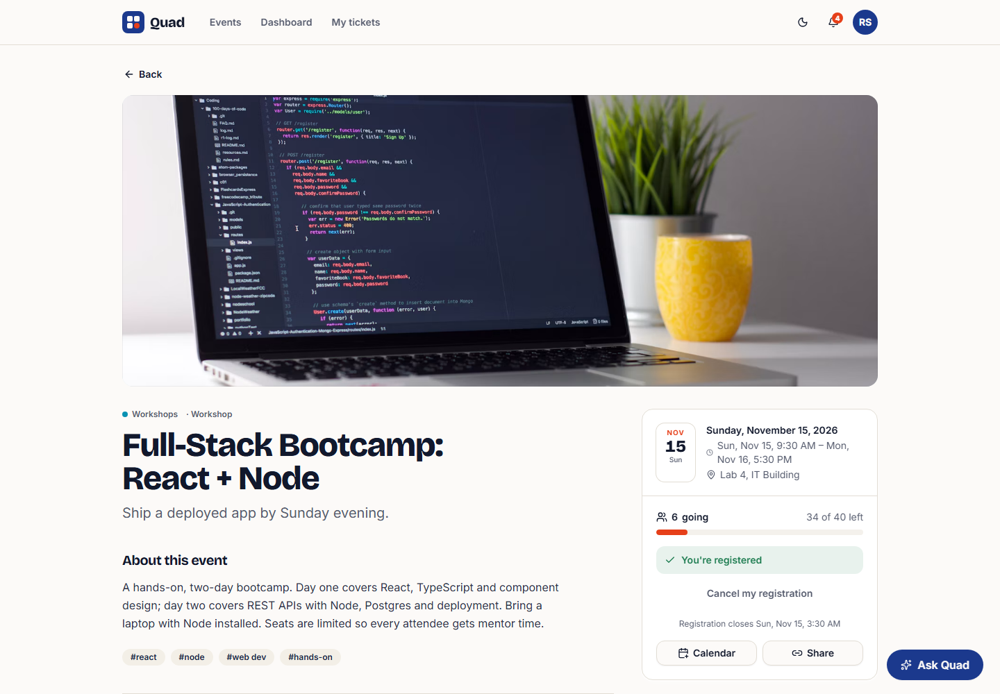
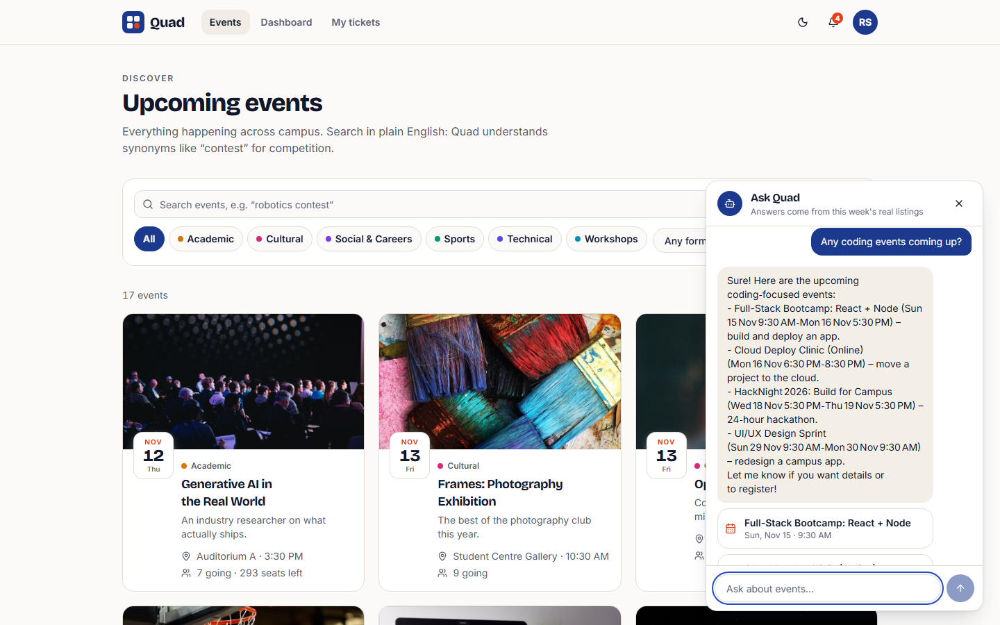
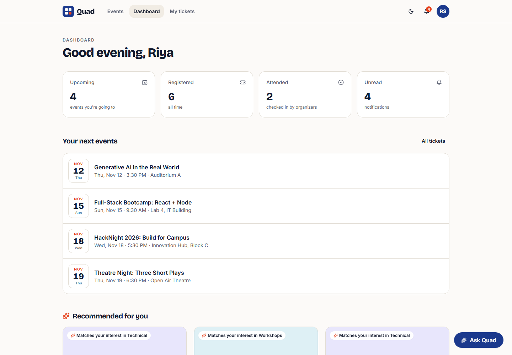
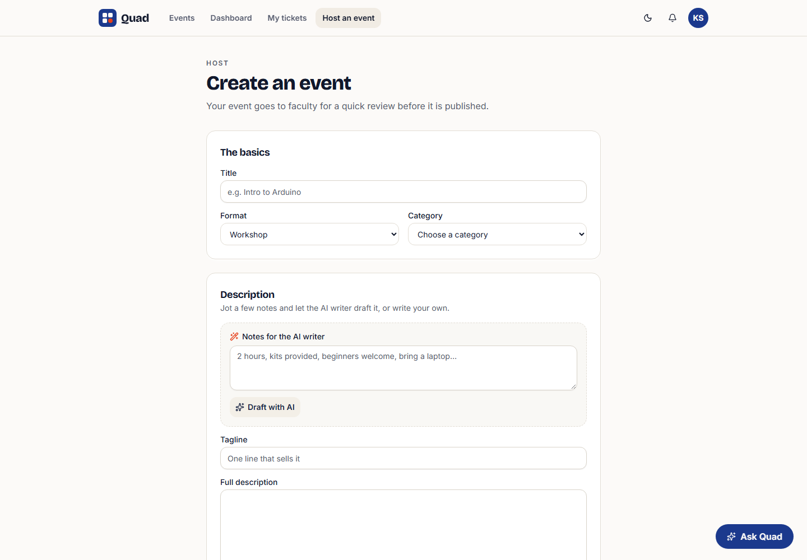
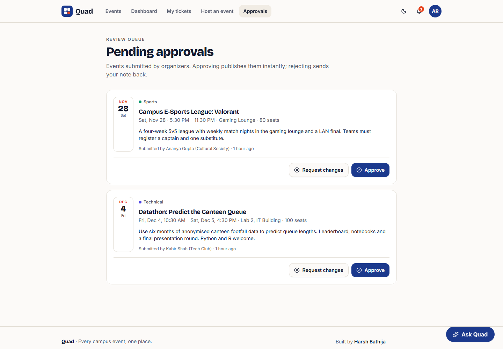
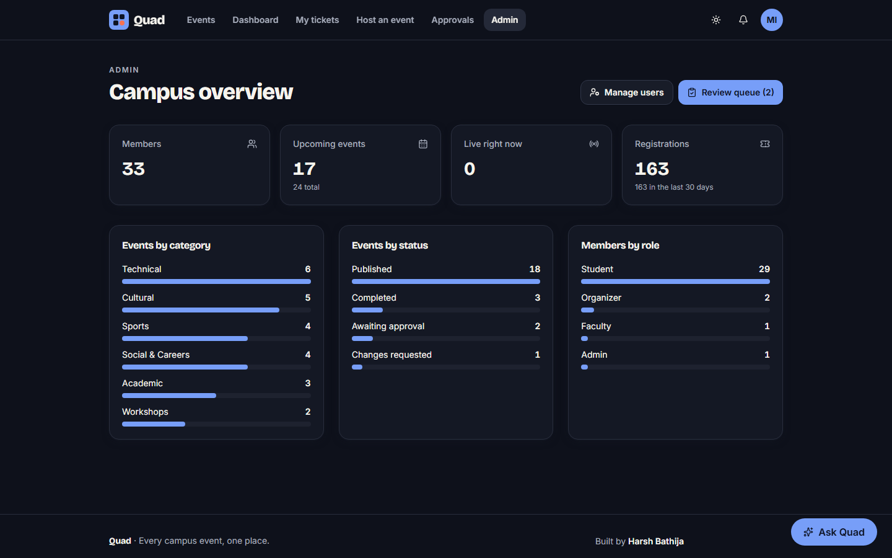
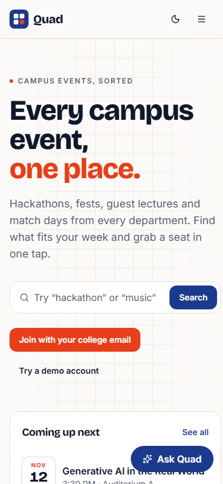
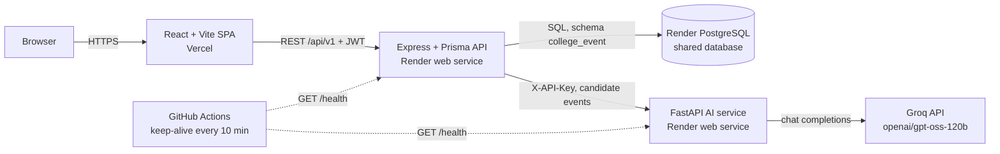

# Quad — College Event Aggregator

**Every campus event, one place.** Students discover and register for hackathons, fests, talks and match days; organizers submit events; faculty approve them; admins see the whole campus at a glance. Personalized recommendations, NLP search and a Groq-powered campus concierge are built in.

| | |
| --- | --- |
| Live demo (Vercel) | `https://<your-app>.vercel.app` _(placeholder)_ |
| API (Render) | `https://quad-api.onrender.com/health` _(placeholder)_ |
| AI service (Render) | `https://quad-ai.onrender.com/health` _(placeholder)_ |

> The API runs on Render's free tier and sleeps when idle. The first request can take 30-60 s; the app shows a "waking up the server" notice while it does.

**Demo accounts** (seeded automatically, password `Demo@1234`): `student@example.edu`, `organizer@example.edu`, `faculty@example.edu`, `admin@example.edu`. The login page has one-click buttons for each.

## Features

- **Discover** upcoming events with category/format filters and natural-language search (stemming, synonyms, intent detection, TF-IDF ranking).
- **Register in one tap**, cancel, add to calendar (`.ics`) and share; live seat counts and capacity bars.
- **Personalized picks**: a hybrid recommender blends interest match, popularity and time-to-event, and explains each pick.
- **Ask Quad** assistant: answers questions like "anything for coders this weekend?" grounded only in real listings (Groq, `openai/gpt-oss-120b`).
- **AI description writer** for organizers: turn a few notes into a polished description, tagline and tags.
- **Approval workflow**: organizer events go to a faculty review queue; approve or request changes with a note; organizers are notified.
- **Role-aware dashboards** for students and organizers, an **admin overview** and **user management** (roles, suspension).
- **Notifications** for confirmations, approvals and reminders (daily cron jobs).
- Polished UI: design tokens, light/dark themes, skeleton/empty/error states, toasts, fully responsive to 375 px, keyboard and screen-reader friendly.

## Screenshots

| Landing | Discover |
| --- | --- |
|  |  |
| **Event detail** | **Ask Quad assistant** |
|  |  |
| **Student dashboard** | **Create event with AI writer** |
|  |  |
| **Faculty review queue** | **Admin overview (dark)** |
|  |  |

<p align="center"></p>

## Architecture



- The **backend owns all data**. For AI features it sends the relevant events to the AI service, which stays stateless; Groq is only ever called server-side.
- Every ML feature has a **rule-based fallback**, so the app keeps working if the AI service is asleep or down. LLM features return clear 429/503 messages instead.
- The database is shared with other portfolio apps; all tables live in the Postgres schema named by `DB_SCHEMA`.

## Tech stack

| Layer | Tech |
| --- | --- |
| Frontend | React 19, TypeScript, Vite 7, Tailwind CSS 3, Radix UI primitives, lucide icons, sonner toasts |
| Backend | Node.js, Express 4, Prisma 5 (PostgreSQL), JWT auth with bcrypt, express-validator, helmet, express-rate-limit, winston, node-cron |
| AI service | Python 3.13, FastAPI, scikit-learn (TF-IDF), NLTK stemming, Groq SDK |
| Infra | Vercel, Render (web services + PostgreSQL), GitHub Actions (CI + keep-alive) |
| Quality | Vitest + Supertest, pytest, ESLint, Ruff, Prettier |

## Local setup

Prerequisites: Node 20+, Python 3.13, and a Postgres database (any local instance works).

```bash
# 1. Backend API (port 5116)
cd backend
cp .env.example .env          # set DATABASE_URL, JWT_SECRET
npm install
npm run db:deploy             # creates the schema and runs migrations
npm run db:seed               # idempotent demo data
npm run dev

# 2. AI service (port 5117)
cd ai-service
python -m venv .venv && source .venv/bin/activate   # Windows: .venv\Scripts\activate
pip install -r requirements-dev.txt
cp .env.example .env          # set AI_SERVICE_API_KEY (same as backend) and GROQ_API_KEY
uvicorn main:app --app-dir src --port 5117 --reload

# 3. Frontend (port 5208)
cd app
cp .env.example .env.local    # VITE_API_URL=http://localhost:5116
npm install
npm run dev
```

Tests and checks:

```bash
cd backend && npm run lint && npm test        # needs DATABASE_URL; uses schema college_event_test
cd ai-service && ruff check src tests && pytest
cd app && npm run lint && npm test && npm run build
```

## Environment variables

| Service | Variable | Required | Description |
| --- | --- | --- | --- |
| backend | `DATABASE_URL` | yes | Postgres connection string (shared Render DB) |
| backend | `DB_SCHEMA` | no | Postgres schema for this app (default `college_event`) |
| backend | `JWT_SECRET` | yes (prod) | Signs access tokens; refresh secret is derived unless `JWT_REFRESH_SECRET` is set |
| backend | `JWT_EXPIRES_IN` / `JWT_REFRESH_EXPIRES_IN` | no | Token lifetimes (default `15m` / `7d`) |
| backend | `FRONTEND_URL` | yes (prod) | Allowed CORS origin(s), comma-separated |
| backend | `AI_SERVICE_URL` | no | Base URL of the AI service (falls back to rule-based features if unreachable) |
| backend | `AI_SERVICE_API_KEY` | yes (prod) | Shared secret sent to the AI service |
| backend | `ENABLE_CRON` | no | `false` disables scheduled notification jobs |
| backend | `PORT`, `NODE_ENV` | no | Set by Render |
| ai-service | `GROQ_API_KEY` | for LLM features | Groq API key; without it the assistant/writer return 503 |
| ai-service | `AI_SERVICE_API_KEY` | yes (prod) | Must match the backend |
| ai-service | `GROQ_TEXT_MODEL` | no | Defaults to `openai/gpt-oss-120b` |
| ai-service | `ENVIRONMENT` | no | `production` disables `/docs` and requires the API key |
| ai-service | `CORS_ORIGINS` | no | Only needed if a browser should call it directly |
| app | `VITE_API_URL` | yes | Backend origin, e.g. `https://quad-api.onrender.com` |

## Deployment

1. **Database** – create (once) the shared Render PostgreSQL instance and copy its connection string.
2. **Render Blueprint** – in Render, *New → Blueprint*, pick this repo. `render.yaml` creates `quad-api` and `quad-ai` (free plan, `/health` checks) plus an env group that generates the shared `AI_SERVICE_API_KEY`. When prompted, set:
   - `quad-api`: `DATABASE_URL` (the shared DB, internal URL), `FRONTEND_URL` (your Vercel URL), `AI_SERVICE_URL` (the `quad-ai` URL).
   - `quad-ai`: `GROQ_API_KEY`.
   Migrations and the idempotent seed run automatically on every boot (`npm run start:prod`).
3. **Vercel** – *Add New → Project*, import the repo, set **Root Directory** to `app`, framework Vite, and env `VITE_API_URL` to the `quad-api` URL. `app/vercel.json` adds SPA rewrites and security headers. Then update `FRONTEND_URL` on Render to the final Vercel domain.
4. **Keep-alive** – in GitHub *Settings → Secrets and variables → Actions → Variables*, add `BACKEND_URL` (the `quad-api` URL) and `AI_SERVICE_URL` (the `quad-ai` URL). `.github/workflows/keep-alive.yml` pings both `/health` endpoints every 10 minutes (and skips cleanly when unset).

## Project structure

```
.
├── app/                     # React + Vite frontend (Vercel)
│   ├── public/              # favicon, OG image
│   └── src/
│       ├── components/app/  # EventCard, AssistantWidget, states, brand
│       ├── components/ui/   # Radix-based primitives
│       ├── hooks/           # auth, theme, async loader
│       ├── layouts/         # main + auth shells
│       ├── lib/             # API client, formatting helpers (+ tests)
│       └── pages/           # route screens
├── backend/                 # Express + Prisma API (Render)
│   ├── prisma/              # schema + migrations
│   ├── scripts/db.js        # schema-scoped Prisma CLI wrapper
│   ├── src/                 # app, routes, controllers, middleware, services, seed
│   └── tests/               # Vitest + Supertest API tests
├── ai-service/              # FastAPI AI service (Render)
│   ├── src/services/        # recommendation, search, categorization, Groq LLM
│   └── tests/
├── docs/                    # project report + screenshots
├── render.yaml              # Render Blueprint
└── .github/workflows/       # CI and keep-alive
```

## Author

Built by [Harsh Bathija](https://github.com/HarshBathija-04). The original MCA project report is in [`docs/`](docs/).
